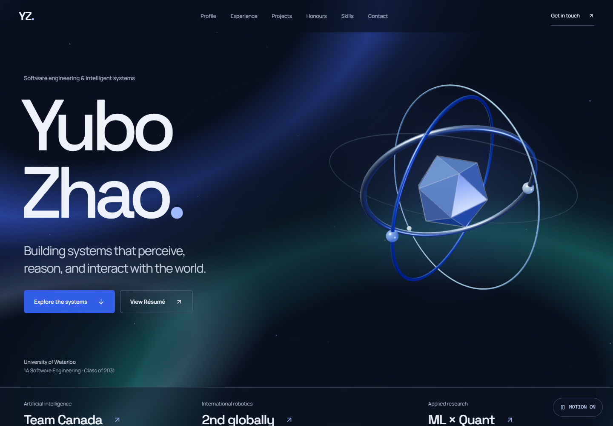
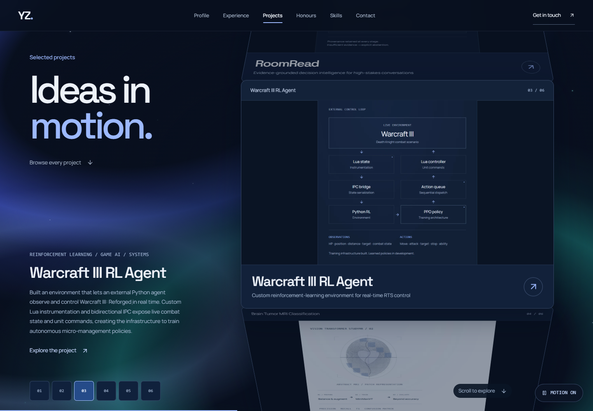

# Yubo Zhao — Personal Portfolio

An engineering portfolio showcasing work across software engineering, AI / machine learning, reinforcement learning, computer vision, robotics, and intelligent systems.

[Live Website](https://personal-website-one-pi-86.vercel.app) · [Architecture](#architecture) · [Run locally](#local-development) · [GitHub](https://github.com/YuboZhao2008) · [Résumé](https://personal-website-one-pi-86.vercel.app/resume.pdf)



The screenshot shows the local redesign preview. The live links above continue to point to the existing deployment until this branch is approved for release.

## Overview

Yubo Zhao's personal portfolio brings together projects, engineering experience, competition achievements, and technical skills as a Software Engineering student at the University of Waterloo. A motion-first editorial layout pairs an original three-dimensional hero sculpture with a rolling perspective project gallery, flowing aurora lighting, and contrasting silver content surfaces. Space Grotesk and Manrope variable fonts are self-hosted through `next/font/local`; their licenses live beside the font files.

Featured work includes Jarvis, RoomRead, the Warcraft III Reinforcement Learning Agent, Brain Tumor MRI Classification, Gesture-Controlled Drawing Interface, and Future-Sim. RoomRead connects provenance-first research with profile-specific pitch analysis. The Warcraft project focuses on the environment and control infrastructure for real-time RTS reinforcement learning; learned policies are still in development.

The robotics background includes three consecutive FTC World Championship qualifications, a 2024 FTC World Championship team result of 2nd Place Globally, and a VEX IQ Robotics Skills team result of 1st Place in the Middle School Division (Dallas, Grade 8).

## Tech Stack

| Area                   | Technologies                                      |
| ---------------------- | ------------------------------------------------- |
| Framework              | Next.js 16 App Router, React 19                   |
| Language               | TypeScript with strict checking                   |
| Styling                | Tailwind CSS 4, authored CSS, Lucide icons        |
| Interaction and motion | GSAP / ScrollTrigger, Motion, Lenis, React Three Fiber / Three.js, CSS, IntersectionObserver |
| Validation             | ESLint, TypeScript, Playwright Core, axe-core     |

## Highlights

- **Responsive layouts:** custom desktop and mobile compositions, with a native modal mobile navigation dialog that handles keyboard focus, Escape, and viewport changes.
- **Interactive technical illustrations:** an orbital hero sculpture, multimodal architecture diagram, RoomRead source–evidence–analysis pipeline, Warcraft observation–policy–action loop, gesture landmark selector, and deterministic world-state controls. These illustrate the featured work; they do not run its AI models or process camera input.
- **Rolling project gallery:** a sticky desktop stage rolls six floating exhibits through a perspective arc with reversible scroll interpolation and direct project selection. Mobile uses individual scroll-responsive panels. Full project records retain every description, engineering note, link, and live diagram. Preview images are captured architecture illustrations, not screenshots of the project applications.
- **Continuous atmosphere:** layered cobalt, teal, and silver auroras, drifting particles, scroll-reactive lighting, kinetic headings, and a reversible SVG journey with a traveling light. The background uses composed CSS layers, avoiding a second WebGL canvas.
- **Motion controls:** coordinated GSAP typography entrances and scroll choreography, desktop-only Lenis smoothing, Motion navigation feedback, project hover responses, and a fixed page-wide pause/resume control. Reduced motion and JavaScript-free browsing retain complete readable content and a static hero sculpture. WebGL rendering pauses offscreen and in hidden tabs; resolution is capped at 1.5 device pixels per CSS pixel.
- **Content available without JavaScript:** prerendered portfolio content and native HTML disclosures for project notes and additional skills.
- **Structured content:** centralized profile data and typed project records select their presentation and visualization, while shared components render experience, achievements, and skills.
- **Public evidence and résumé:** project links render only when configured with valid HTTPS destinations; the public résumé PDF is linked from the hero and contact section.
- **Search and sharing metadata:** a generated 1200 × 630 sharing image, plus canonical and sitemap URLs derived from an optional configured origin.

## Architecture



```text
src/
├── app/          Page composition, layout, global CSS, metadata routes
├── components/   Sections, navigation, project displays, interactive diagrams
├── data/         Typed portfolio content and site configuration
└── styles/       Styles for navigation, hero, projects, and other sections
scripts/
├── check-browser.mjs   Browser and accessibility validation
├── check-redesign.mjs  Visual captures and local performance measurements
└── check-cinematic.mjs Idle motion, reversible scroll, and gallery validation
docs/
└── images/       Curated README screenshots
```

[`src/app/page.tsx`](src/app/page.tsx) composes the page from reusable sections. Server Components render the content, with Client Components handling navigation, diagram state, and motion. The home page, crawler metadata, and sharing image are prerendered during the production build.

Animation ownership is explicit: GSAP controls typography, gallery panel transforms, scroll depth, and journey progress; Motion controls navigation feedback; CSS controls aurora loops, particles, nested preview activity, and diagram activity; Three.js controls only the deferred hero canvas. These systems do not animate the same element properties. Pausing motion or requesting reduced motion converts the gallery into a complete static layout and renders the journey fully drawn. Background loops pause in hidden tabs. No external textures, models, or postprocessing are required. Drei remains installed for future work but is not included in the page bundle.

The October 2026 dependency fixes are retained: Next.js / eslint-config-next 16.3.8, Sharp 0.35.5, source-map-js 1.2.2, and patched brace-expansion copies. The production audit reports zero vulnerabilities. The known development-only `braces` stack-exhaustion advisory still propagates through five ESLint dependency entries; no compatible published patch was available during the health check. The unnecessary `unrs-resolver` postinstall remains unapproved; its installed Windows native binding works without it.

## Local Development

Use **Node.js 24** and npm, matching the validated development runtime. From the cloned repository:

```sh
npm ci
npm run dev
```

Open [localhost:3000](http://localhost:3000). `npm ci` installs the versions recorded in the lockfile. On Windows, use `npm.cmd` if PowerShell blocks `npm.ps1`.

No environment variables or API credentials are required. For local metadata testing, copy [`.env.example`](.env.example) to `.env.local` and set the optional `SITE_URL`.

## Production Build

```sh
npm run build
npm start
```

The production server uses [localhost:3000](http://localhost:3000). Stop any development server using that port first.

## Validation

```sh
npm run typecheck
npm run lint
npm run build
```

Type-checking generates Next.js route declarations before running TypeScript, so it also works before the first development server or build.

With a development or production server running, use a second terminal for browser validation:

```sh
npm run test:browser
```

Use the same `SITE_URL` value as the tested build when running the suite so metadata assertions match that build.

The suite checks eleven viewport widths from 320 to 1920 pixels, horizontal overflow, keyboard and touch interactions, mobile focus isolation and restoration, disclosures, motion preferences, punctuation, optional links, diagram bounds and mobile label sizes, production metadata, browser errors, and content without JavaScript. RoomRead checks cover project order and exact preserved content, its explicit pipeline renderer, readable labels, mobile stacking, disclosures, motion, absent evidence links, and meaningful no-JavaScript copy. Warcraft-specific checks cover its control-loop diagram, stacked layout, readable labels, and ambient motion. axe-core scans representative mobile, tablet, and desktop widths for WCAG A/AA rule violations.

| Browser test option | Default / usage                                                                                                           |
| ------------------- | ------------------------------------------------------------------------------------------------------------------------- |
| `BASE_URL`          | `http://127.0.0.1:3000`; override to test another local port or the deployed site                                         |
| `BROWSER_PATH`      | Standard Windows Chrome installation; set an absolute path to an installed Chrome or Chromium executable on other systems |

Playwright Core uses an existing browser and does not download one. Test screenshots and reports are written to ignored `test-results/`.

Run `node scripts/check-cinematic.mjs` against the same server to verify normal and reduced motion independently at desktop, tablet, and mobile sizes. It captures multiple scroll positions, compares idle background frames, checks forward/reverse gallery and SVG progression, and exercises keyboard project selection.

The [README screenshot](docs/images/portfolio-homepage-2026-10.png) is a local redesign preview at 1440 × 1000 with motion enabled. Run `node scripts/check-redesign.mjs` against a running server to capture desktop, tablet, mobile, normal-motion, and reduced-motion views. This also records local browser LCP/CLS/resource measurements and axe results in `test-results/redesign/`; these are local measurements, not field Core Web Vitals or Lighthouse scores.

## Content Management

Edit [`src/data/profile.ts`](src/data/profile.ts) for profile information, education, projects, experience, achievements, skills, navigation links, and social destinations. Edit [`src/data/site.ts`](src/data/site.ts) for the site title, description, and origin handling.

Each project includes an ID, description, technologies, engineering notes, a `presentation` (`flagship`, `case-study`, or `secondary`), and a `visual` (`intelligence`, `roomread`, `warcraft`, `medical`, `gesture`, or `simulation`). Optional `evaluation` data includes measurement context. `originalTitle` preserves a formal or résumé project name when its display title is clarified.

When adding projects, add a matching `public/project-previews/<id>.webp` illustration and review `rolling-project-gallery.tsx`; the gallery and browser checks use the configured project count. Adding a new visualization also requires extending the `Project` type and `ProjectVisual` renderer. Substantial diagrams have standalone components, including `jarvis-visual.tsx`, `roomread-visual.tsx`, and `warcraft-visual.tsx`. All six projects receive a gallery panel and a native details record; the original presentation metadata remains available for other layouts. Shared section copy lives in the components.

| Configuration in `src/data/profile.ts`                                               | Behavior                                                                                            |
| ------------------------------------------------------------------------------------ | --------------------------------------------------------------------------------------------------- |
| `profile.socials.resume`                                                             | HTTPS résumé URL or site-relative PDF path; enables **View Résumé** in the hero and contact section |
| `profile.socials.github`                                                             | Your verified GitHub profile URL; shown in contact                                                  |
| `profile.opportunity.targetRoles`                                                    | Concise areas of interest, shown subtly in contact                                                  |
| `profile.opportunity.status` / `availability`                                        | Optional confirmed opportunity status and availability text; no date is assumed                     |
| Project `repositoryUrl`, `demoUrl`, `caseStudyUrl`                                   | Optional evidence actions; only configured HTTPS destinations render                                |
| Achievement `verificationUrl`, `team`, `teamNumber`, `resultDetail`, `scope`, `year` | Optional verification and context; missing fields remain hidden                                     |

Keep unknown values `null` (or an empty `targetRoles` array). Evidence URLs are unset until the corresponding work is ready to share. The résumé is served from `public/resume.pdf` at `/resume.pdf`; replace that file to update it. Both résumé actions open in a new tab. Link handling is centralized in `src/data/links.ts`.

## Deployment

The site runs on Vercel with `main` as the production branch. Pushes to `main` trigger production deployments through [Vercel's Git integration](https://vercel.com/docs/git); branch changes use preview deployments. The project uses the repository root, Node.js 24.x, `npm ci`, `npm run build`, and the default [Next.js settings](https://vercel.com/docs/frameworks/full-stack/nextjs).

`SITE_URL` is configured in Vercel's Production environment as `https://personal-website-one-pi-86.vercel.app`. It supplies canonical, sitemap, and sharing-image URLs at build time. It remains optional locally: when unset, those absolute URLs are omitted while the site and `/share-image` still work. Keep it unset in Preview unless previews should use the production canonical origin.

A custom domain can be added later. When changing the primary domain, update production `SITE_URL`, the public website and résumé links in this README, and GitHub's **About → Website** field, then rebuild to apply the metadata change.
